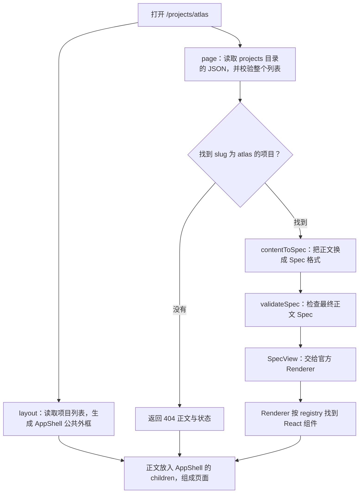

# Web Standard：从 JSON 到页面

一个便于跟读源码的小例子，保留 pnpm workspace、Next.js App Router、Tailwind CSS 和官方 json-render。项目从本地 JSON 目录自动读取，附带 Atlas / Orbit 两个样例。

当前样例对应三个实际页面：

| URL               | 内容                       | 路由文件                                    |
| ----------------- | -------------------------- | ------------------------------------------- |
| `/`               | Atlas / Orbit 两个项目入口 | `apps/web/src/app/page.tsx`                 |
| `/projects/atlas` | 卡片和任务列表             | `apps/web/src/app/projects/[slug]/page.tsx` |
| `/projects/orbit` | 简短阅读计划表格           | 同一个 `projects/[slug]/page.tsx`           |

所有项目共用一个动态路由，按 slug 查找读取并校验后的项目列表。未知 slug 返回真实 404。analytics 已移除，旧统计地址也返回 404；没有编辑工作台、写入 API 或浏览器会话存储。

在 `packages/data/src/projects` 增删或修改 JSON 后完整刷新页面，首页入口、共同导航和项目详情会使用新数据，无需维护 import 清单。只读取目录直接子级的普通 `.json` 文件，按文件名字典顺序排列，不递归、不跟随符号链接。JSON 格式、项目 schema 或 slug 唯一性校验失败会明确报错。

## 运行

需要 Node.js 24+、pnpm 12.14.0（版本以 package.json 和 lockfile 为准）。

```sh
pnpm install --frozen-lockfile
pnpm dev
# http://localhost:3000
```

不需要数据库、环境变量或第二个服务。脚本从 `apps/web` 启动 Next，服务据此定位数据目录，每次调用 `getProjects()` 都重新读取，不保留模块级项目列表缓存。

部署时必须包含项目 JSON 目录并保留相对目录关系，Next 配置已声明所需的文件追踪范围。刷新只会读取运行环境中的文件；不可变部署新增 JSON 仍需正常构建发布，本地源码变化不会自动同步线上。

## 从 JSON 到页面：用大白话走一遍

JSON 写“页面放什么、先后怎么排”；React 组件负责“具体长什么样”；中间这条链路负责读取、检查和连接它们。下文的 slots 指卡片页头、页脚这样的命名区域。

以打开 `/projects/atlas` 为例，入口是 [详情页 page.tsx](apps/web/src/app/projects/[slug]/page.tsx)，所有项目都走这一个页面文件。



图里的每一步，对应这些实际文件：

| 步骤            | 文件                                                                                                  | 大白话解释                                                                                         |
| --------------- | ----------------------------------------------------------------------------------------------------- | -------------------------------------------------------------------------------------------------- |
| 1. 准备内容     | [projects/atlas.json](packages/data/src/projects/atlas.json) 等项目 JSON                              | `slug` 决定地址，`name` / `description` 提供项目介绍，`content` 写正文的组件、内容、顺序和 slots。 |
| 2. 读取和选择   | [project-repository.ts](packages/data/src/project-repository.ts)                                      | `getProjects()` 读出并校验整个列表，`getProject()` 再从中找出 atlas。不会拿 URL 参数去拼文件路径。 |
| 3. 转换格式     | [content-to-spec.ts](packages/render/src/content-to-spec.ts)                                          | `contentToSpec()` 把嵌套正文换成 json-render 使用的 Spec，内容和顺序保留。                         |
| 4. 检查最终结果 | [validate-spec.ts](packages/data/src/validate-spec.ts) + [catalog.ts](packages/render/src/catalog.ts) | 检查组件和属性能不能用、slot 对不对、引用有没有缺失或循环。                                        |
| 5. 开始渲染     | [spec-view.tsx](packages/render/src/spec-view.tsx)                                                    | `SpecView` 把 Spec 交给官方 `JSONUIProvider` 和 `Renderer`。                                       |
| 6. 找到组件     | [registry.tsx](packages/render/src/registry.tsx)                                                      | 将 Spec 里的名称对应到实际组件，例如 `Table → UI.Table`，并传入属性和子内容。                      |
| 7. 画出正文     | [ui/src/components](packages/ui/src/components)                                                       | `Heading`、`Card`、`Button`、`List`、`Table` 等普通 React 组件输出带 Tailwind 样式的 HTML。        |
| 公共外框        | [layout.tsx](apps/web/src/app/layout.tsx)                                                             | 读取项目列表生成导航，直接用 `AppShell` 包住当前页面的 `children`，首页、详情和 404 共用。         |

第 2 步的“校验”发生在读取函数内部，用到三个规则文件：

- [project-schema.ts](packages/domain/src/project-schema.ts)：项目字段有没有填对，slug 有没有重复。
- [content-schema.ts](packages/domain/src/content-schema.ts)：正文组件、子节点、命名 slots 和节点 ID 有没有问题。
- [component-props-schema.ts](packages/domain/src/component-props-schema.ts)：每个组件的属性是否合法，例如 Grid 只能有 1–4 列。源内容 schema 和 catalog 共用这些属性规则。

可以这样区分几个容易混淆的名字：**Spec 是页面结构数据，catalog 规定允许用什么，registry 指定由哪个 React 组件实现，Renderer 负责把它们渲染出来。**

公共外框组件叫 `AppShell`，实现在 [app-shell.tsx](packages/ui/src/components/app-shell.tsx)，负责导航、正文区域和页脚。layout 直接使用这个 React 组件，json-render 只处理正文，不再为外框增加 Spec 元素或组件注册。layout 和页面分别调用同一个 `getProjects()` 数据入口；完整刷新会重新读取 JSON，站内跳转时 Next.js 会复用共享 layout。

### 一个标题是怎么变出来的

Atlas 的 JSON 中写的是：

```json
{ "id": "atlas-title", "type": "h1", "props": { "text": "Atlas 项目" } }
```

转换器将它放入 `spec.elements["atlas-title"]`：

```json
{
  "type": "Heading",
  "props": { "text": "Atlas 项目", "level": 1 },
  "children": []
}
```

Renderer 通过 registry 找到 `Heading` 组件，最终得到 `<h1 class="…">Atlas 项目</h1>`。

完整 Spec 中，`root` 指向正文起始元素的 ID，例如 Atlas 的 `atlas`、首页的 `home`，没有固定的外框 ID；`elements` 按 ID 保存所有元素。原来嵌套在 JSON 里的 children 和 slots，会变成子元素 ID 列表。转换器只换格式，不擅自补标题、按钮或正文。`Button`、`List`、`Table` 等名称保持不变，h1…h6 转成 Heading(level)，p 转成 Text。

### 首页和详情有什么不同

详情页使用选中项目的 `content`。首页使用整份项目列表，由 [home-spec.ts](packages/data/src/home-spec.ts) 生成项目卡片和入口：

```text
详情：getProjects → getProject → contentToSpec → validateSpec → SpecView
首页：getProjects → homeSpec                  → validateSpec → SpecView
```

两个页面共用后面的渲染过程。项目的 `name` 用于首页、导航和网页标题，`description` 用于首页简介；详情正文由 `content` 决定。改项目名称不会自动改正文里的标题。

读取 JSON 和转换 Spec 都发生在服务器。`SpecView` 虽然有 `"use client"`，Next.js 首屏仍会输出包含正文的 HTML，浏览器随后接管链接导航等交互。layout 负责 html / body、全局样式和公共外框，不参与正文格式转换。

继续跟读代码可看 [中文阅读指南](docs/reading-guide.md)。四个包的职责是：`domain` 定义规则，`data` 读取数据和组合页面，`render` 对接 json-render，`ui` 实现组件。

## 验证

```sh
pnpm format:check
pnpm lint
pnpm typecheck
pnpm test
pnpm build
pnpm test:http
```

`test:http` 在构建后临时启动并关闭 3200 端口的生产服务，验证首页和样例详情、导航、SSR、无效 slug 和移除入口的 404。实际结果见 [验证记录](docs/validation.md)，开发约定见 [AGENTS.md](AGENTS.md)。线上预览尚未部署本次修改。
